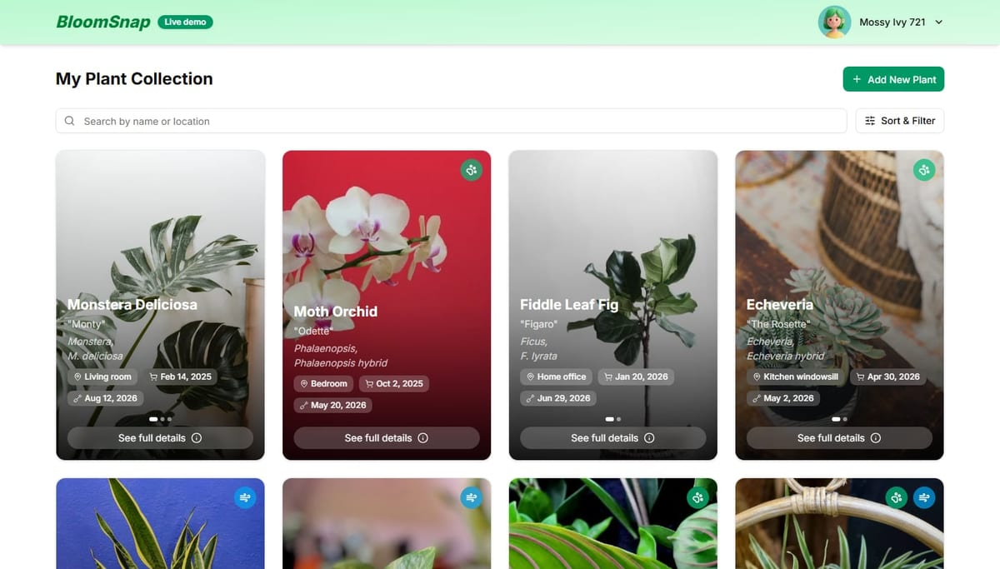
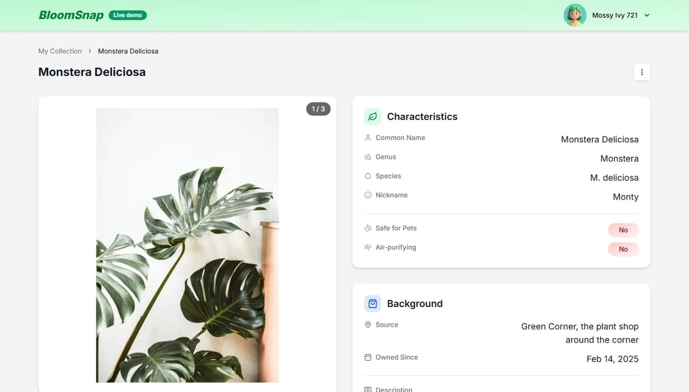
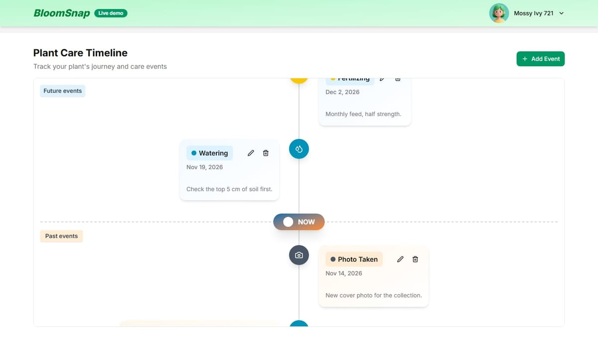

# Bloom Snap 🌸

**A plant collection tracker: every plant gets a profile, a photo gallery, care notes and a care timeline.**

Full-stack web app built with **Next.js 15**, **React 19**, **TypeScript**, **Prisma** and **PostgreSQL**. Created as an engineering thesis project.

### ▶ [Try the live demo](https://bloom-snap-web.vercel.app/demo)

One click, no sign-up. You get a private sample collection of 12 plants to explore, edit and break.

> [!NOTE]
> Google sign-in is currently disabled on the live version. Opening it to the public would require Google's app verification (a privacy policy, terms of service and so on), which is beyond the scope of a portfolio project. The live demo is the recommended way to explore the app. Email and password sign-up works as well.

<p align="center">
  
</p>

---

## Features

- **Plant collection** with search by name or room, sorting, pagination and filters for pet friendly and air cleaning plants.
- **Plant profiles** with a photo gallery (up to 5 photos), botanical details, growth data, environment and potting mix.
- **Care notes** for watering, misting, leaf cleaning and fertilizing.
- **Care timeline** per plant: over 40 predefined event types (watering, repotting, pests, new leaves and more) or fully custom ones with your own icon and colour. Planned events show up above a "now" marker.
- **Accounts** with email and password or Google sign-in, an editable profile and preset avatars.
- **Responsive** layout, from phone to desktop.

<table>
  <tr>
    <td align="center"><br /><sub>Plant profile</sub></td>
    <td align="center"><br /><sub>Care timeline</sub></td>
  </tr>
</table>


---

## Tech Stack

- **Language:** TypeScript
- **Framework:** Next.js 15 (App Router, Server Components, Server Actions)
- **Frontend:** React 19, Tailwind CSS, shadcn/ui, Lucide React Icons
- **Authentication:** Auth.js (email and password, Google OAuth)
- **Database:** PostgreSQL (Neon) with Prisma ORM
- **File storage:** Vercel Blob (private store, plant photos)
- **Forms & Validation:** React Hook Form + Zod
- **Hosting:** Vercel

---

## Running Locally

### Requirements

- **Node.js 22** (check with `node -v`; with nvm: `nvm install 22 && nvm use 22`)
- Environment variable values, provided by the project owner

### 1. Clone and install

```bash
git clone https://github.com/zlenczyk/bloom-snap-web
cd bloom-snap-web
npm install
```

### 2. Environment variables

Copy `.env.example` to a new file named `.env` in the project root and fill in the values from the project owner. Both Prisma and Next.js read this file.

```env
DATABASE_URL=
DIRECT_URL=
AUTH_SECRET=
AUTH_GOOGLE_ID=
AUTH_GOOGLE_SECRET=
BLOB_READ_WRITE_TOKEN=
```


### 3. Database

Generate the Prisma Client and apply the migrations from `prisma/migrations/` to your database:

```bash
npx prisma generate
npx prisma migrate deploy
```

### 4. Start the app

```bash
npm run dev
```

The app runs at http://localhost:3000. Open http://localhost:3000/demo for a sample collection, or sign up with an email and password.

### Changing the database schema

After editing `prisma/schema.prisma`, create and apply a migration, then regenerate the client:

```bash
npm run migrate -- --name short_description
npm run generate
```

`npm run migrate` runs `prisma migrate dev`, which needs a database you can reset, so use it on a development database only. The production build (`npm run build`, used by Vercel) applies pending migrations automatically with `prisma migrate deploy`.
